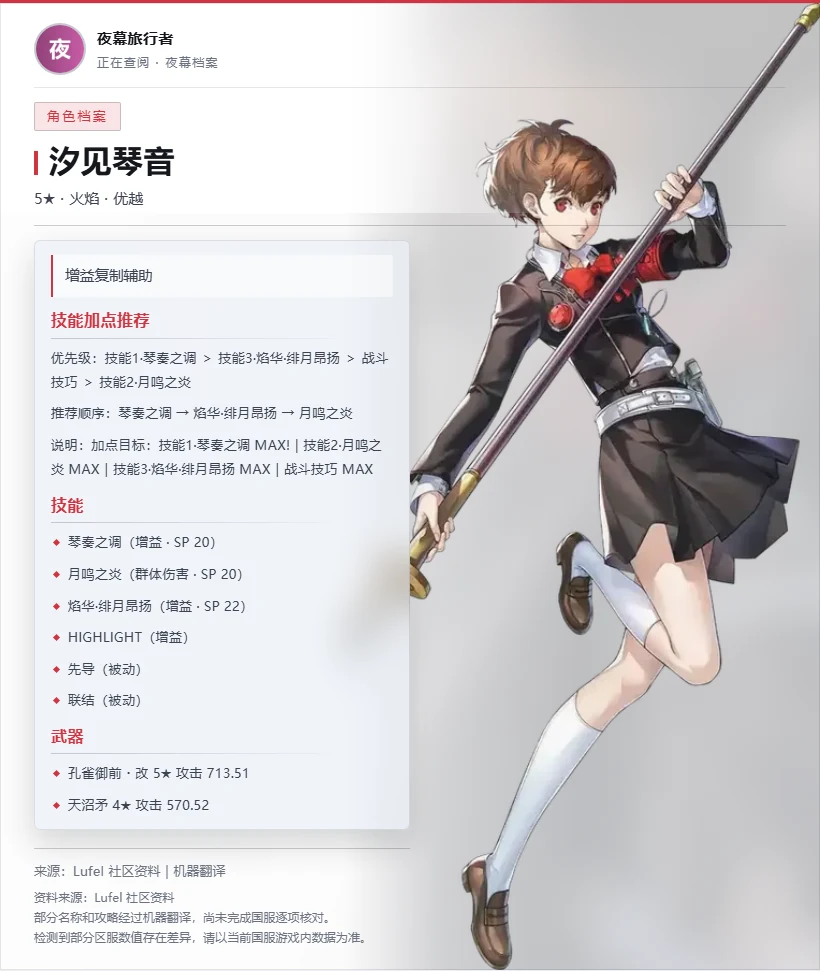
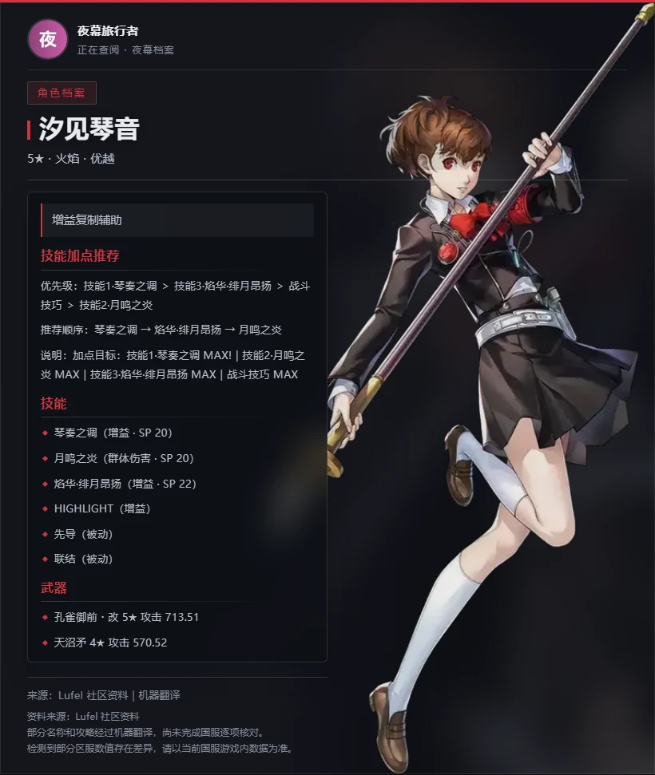
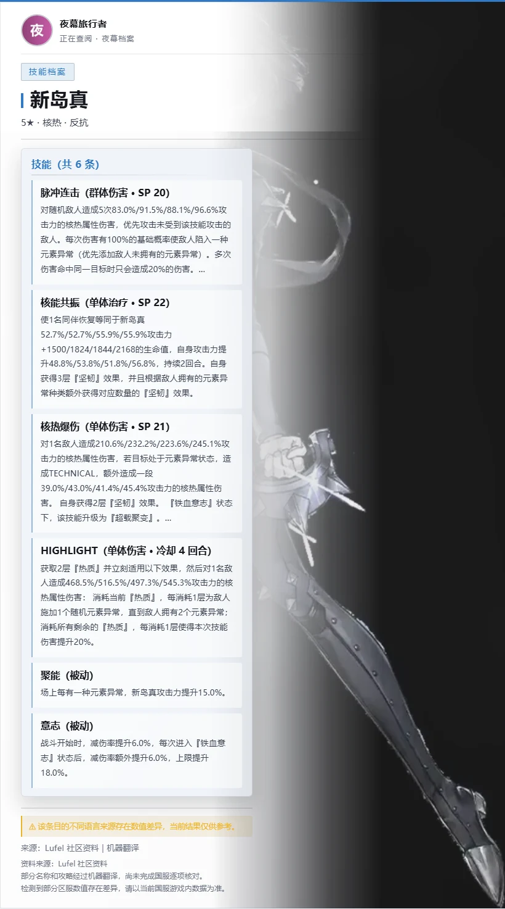
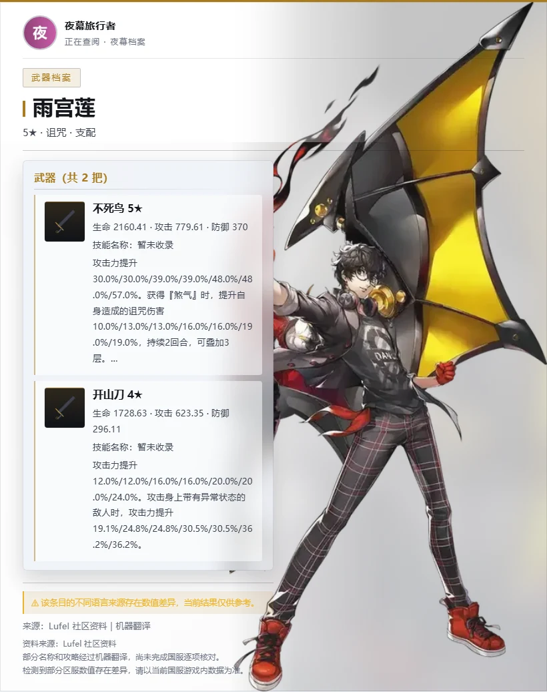
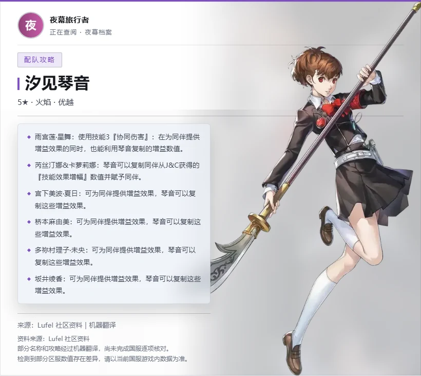
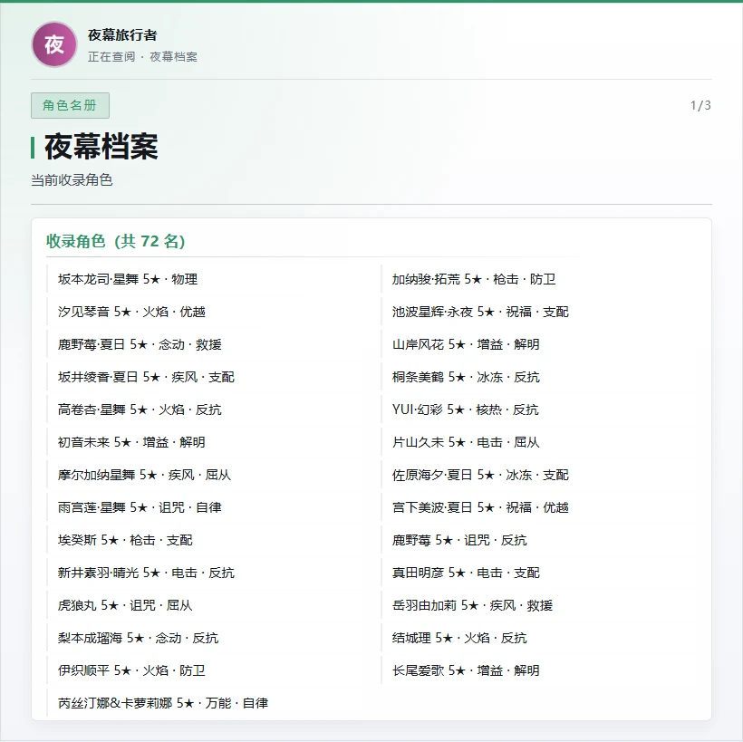
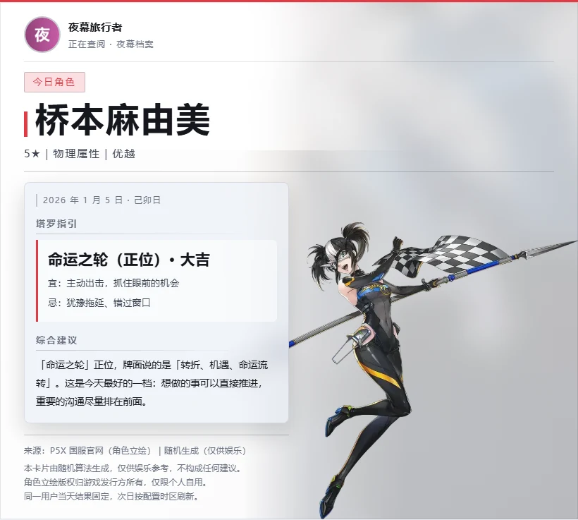
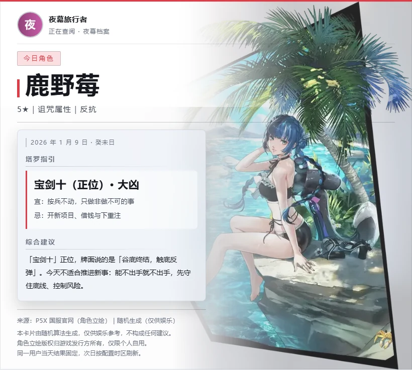

# 夜幕档案

v0.11.2：深化主动识图面板点评精度与数值对标：
- 新增左侧属性框 2× 局部精扫，补齐首行易漏数字（完整识别生命值/攻击力/防御力/速度/精力回复/伤害加成等全部 6 项面板属性）。
- 完整解析一图流多档推荐属性值（`无心象档` / `常规心象档` / `6意识档` / 上限约束），逐档计算当前面板差值或超出值，并注明进图/站街口径。
- 同步解析游戏截图右侧「核心属性目标」并与面板逐项比对；未装专武时自动引用一图流专武提升率，附带推荐循环与核心实战提醒。

v0.11.1：主动识图点评默认改为**直接发送结构化文字评价**（含面板速览、逐项达标/可优化点评、练度评级与推荐循环），并新增配置项 `auto_panel_review_output_mode`（可选 `text` / `image` / `both`，默认 `text`）。

v0.11.0：新增**纯本地主动识图点评角色面板**（基于 `rapidocr-onnxruntime` 本地 CPU OCR，不使用任何 LLM 视觉模型）。
- 用户在群聊或私聊直接发送 P5X 游戏内角色面板截图时，自动识别角色名、等级、属性、技能等级、启示卡套装、武器名与综合评分，并对照一图流数据逐项点评（启示卡首选/备选、专武与满级、副词条数值门槛、核心技能加点）与 `S/A/B/C` 练度评级，输出单张点评卡片（无 T2I 时降级文字）。
- 三层防误触发（尺寸比例预筛 + P5X 面板锚点校验 + 角色名匹配），非面板图片静默忽略；新增配置项 `auto_panel_review_enabled`（默认开启）与 `auto_panel_review_cooldown_seconds`（默认 10 秒冷却）。

v0.10.1：优化角色一图流单卡版式与三套背景视觉融合：取消全屏遮罩与右上封闭立绘框，将右侧 25% 全高区域完整留给原生背景美术与全身角色+人格面具立绘；顶部采用悬浮无框标题（自动避让 P3R / P5X 标志），所有信息栏板高度紧凑包裹文字内容。

v0.10.0：接入作者「强效召唤」B 站合集专栏《磨练欲望：30S就能看懂的一图流攻略》结构化数据源（50 条角色一图流、覆盖 48 名角色含双子 3 种模式与常驻合集，以及 6 张全角色对比附表）。
- `/p5x角色 <角色名>` 命中一图流时**固定只输出 1 张完整信息卡片**（不再分页），适配黑黄 / P3 蓝 / P5 红三套背景及透明人物+人格面具立绘；双子支持 `/p5x角色 双子反抗`、`双子救援`、`双子优越`。
- `/p5x评价`、`/p5x养成`、`/p5x操作`、`/p5x配队` 在与原库数据重复时以一图流为准，未收录角色自动回退原数据库。
- 新增附表查询指令：`/p5x倍率`（全角色输出定位倍率梯度表）、`/p5x辅助榜`（常见辅助提升榜单）、`/p5x榜单` / `/p5x附表`（查看全部 6 张附表），均支持无斜杠触发。
- 补充常用社区昵称别名（`双子`、`贼头`、`星舞杏`、`水美波`、`风花`、`美鹤`、`小学生`、`初音` 等）。

v0.9.1：补齐五星 SP 角色“平野亚兰凛华”的技能倍率、被动、意识、专武属性、加点顺序与操作循环；专武名称修正为“千镜的余烬”。普通四星平野亚兰保持不变。

v0.9.0：每日运势支持指定角色与严格形态别名，例如 `运势 双叶`、`p5x运势 sp素羽`、`p5x运势 周星驰`；新增“今日课题”抽取模块，并完成三套背景及角色+武器宽构图立绘的尺寸适配。

v0.8.9：五星 SP 角色“平野亚兰凛华”加入角色资料与每日运势卡池，配套人物立绘和人格面具立绘；原版四星平野亚兰保持不变。

v0.8.8：卡片正文已针对三套原生背景放大为 23px，条目标题为 25px；较长查询使用更短分页。图片底部不再展示来源、资料来源及附带说明栏，腾出的空间用于正文排版。文字回复的来源信息保持原有行为。

### 人格面具立绘（v0.8.7）

配置项 **人格面具立绘**（`show_persona_art`，默认开启）会在展示人物立绘时，补充对应的人格面具后景。人物和人格面具为独立透明图层，黑黄、P3 蓝色、P5 红色背景分别适配尺寸与位置。关闭此开关后恢复原人物布局；关闭人物立绘时不会单独展示人格面具。

人物与人格面具按原素材配对，缺少已确认配套素材的角色保留人物立绘。武器页展示真实武器图时不叠加人格面具；缺图回退到人物立绘时使用该人物的配套面具。直接发送的官方角色信息原图不经过卡片渲染。

### 三套背景与轮换

v0.8.6 修复旧版 T2I 服务忽略视口尺寸时只截取左上角的问题：使用整页截图与显式完整画布范围，并校验返回图片比例。

v0.8.5：三套背景均使用原图比例的固定画布，黑黄为 1482×1062，蓝色、红色为 1672×941。人物、标题、标签与信息板加入柔和阴影；信息板采用半透明与弱边框。资料查询改用较短分页，避免为容纳长内容拉伸背景。渲染请求显式设置画布宽高。

角色、每日运势、技能、武器、配队、攻略和角色名册共用三套背景，默认每次出图按「黑黄 → P3蓝色 → P5红色」依次轮换。同一次查询的多页使用同一背景，重启插件后从黑黄开始。轮换只改变样式，不改变当天角色、塔罗或运势结果。

通过 **背景模式**（`card_background_mode`）统一选择 `sequential`（默认顺序轮换）、`random`（每次独立随机选择，可能重复）或 `fixed`（固定背景）。同次查询分页统一背景。固定模式使用 **指定背景图**（`card_background`）：

| 配置值 | 背景 | 适配 |
| --- | --- | --- |
| `phantom` | 黑黄装饰字 | 米白字、深色信息板，右侧透明立绘 |
| `reload_blue` | P3蓝色月亮 | 深蓝字、浅色信息板，避开左上角大标题 |
| `phantom_red` | P5红色 | 白字、暗红信息板，避开左上角标志 |

背景均随插件内嵌发送给渲染服务，无需外链。三套背景接管文字配色，原 `image_theme` 只在背景素材缺失时作为回退。SP亚兰的角色指令直接返回官方原图，不参与背景轮换。

### 官方角色信息图

发送 `/p5x角色 sp平野亚兰`，会直接返回一张「平野亚兰凛华」官方中文属性与战斗机制信息图，不需要配置图片渲染服务。也支持 `平野亚兰sp`、`SP亚兰`、`亚兰SP`、`平野亚兰凛华` 和兼容写法 `平野亚兰·凛华`。开启无斜杠指令后，`p5x角色 sp平野亚兰` 同样有效。

普通 `平野亚兰` 仍查询原版资料。未配置官方图或图片缺失的角色继续使用原有数据库查询。此官方原图入口直接发送已有图片，不受卡片渲染开关控制。

后续为其他角色添加官方图时，将图片放进 `data/official_profiles/`，并在 `index.json` 中登记正式名称、别名、来源和有序图片路径即可。别名精确匹配，不会自动把未登记的 SP 形态对应到原版。

> 面向 AstrBot 的《女神异闻录：夜幕魅影》资料查询与每日运势插件。

[](https://github.com/AstrBotDevs/AstrBot)
[](https://github.com/Yamabuki-Kirio/astrbot_plugin_phantom_archive/releases)

### 不带 `/` 的指令（v0.8.3）

在插件配置中打开 **兼容不带斜杠的指令**（`enable_plain_commands`，默认关闭），即可直接发送：

- `夜幕帮助`
- `p5x角色 JOKER`、`p5x技能 J&C`、`p5x攻略 汐见琴音`
- `p5x每日运势`、`p5x今日运势`、`p5x运势`、`p5x今日角色`
- `运势 双叶`、`p5x运势 sp素羽`、`p5x运势 周星驰`

现有全部指令均支持省略 `/`，包括管理员指令（仍需原有管理员权限）。
无斜杠查询的命令和参数必须用空格分开，不识别 `p5x角色JOKER`，也不匹配聊天句子中的指令。

运势支持 `今日运势`、`每日运势`、`运势`，以及 `p5x每日运势`、`p5x今日运势`、`p5x运势`；这些写法均支持带 `/`，开启 `enable_plain_commands` 后也支持不带 `/`。指令后可带角色名或已登记别名，指定该角色的立绘和形态；不带角色时继续随机抽取。同一用户当天的塔罗、吉凶与今日课题保持固定。
命令和角色参数必须用空格分开。开启后命中的消息会停止后续处理，避免重复回复；
若与其他插件的同名指令冲突，可关闭本开关。原有带 `/` 的命令不受本入口影响。

实现参考抽卡插件 `fb00452` 的可选消息入口；本地路由与开关测试已覆盖。
尚未在 AstrBot 实际运行环境验证指令分发及图片发送。
[](https://www.python.org/)

查询角色、技能、武器、意识、养成、操作、评价、配队与攻略，并通过可配置的
T2I 服务生成带用户头像、角色立绘和武器图片的卡片。图片服务不可用时会自动
降级为文字，不影响基础查询。

## 功能特色

- 角色、技能、武器、意识、养成、操作、评价、配队和综合攻略查询
- 角色卡内展示技能加点推荐
- 中文名、原名、英文代号和 slug 多种检索方式
- 暗色 / 浅色图片卡片，支持用户头像、角色立绘和武器缩略图
- 角色立绘 `73/73`，共76张；武器图片 `139/143`
- 每日运势：随机或指定角色（立绘）+ 塔罗吉凶 + 今日课题，附宜忌与综合建议
- 普通、SP、星舞、夏日等形态采用明确别名表，普通名不会误匹配到特殊形态
- 角色+武器、宽特效等宽构图立绘会自动放大，避免人物主体在卡片中视觉偏小
- 抽到对应大阿卡纳时，优先选择已进入 P5X 的 P3 / P5 对应角色
- 同一用户当天结果固定，跨群、改名和重启后保持一致
- 资料数据库只读；每日运势单独写入 `p5x_daily.sqlite3`
- 中文数据库、角色立绘和武器图片均随仓库发布，安装后即可使用
- 渲染失败自动回退文字，不调用 LLM

## 预览

下图全部由插件自带的模板 + 真实数据库渲染，没有手工修图（截图里的发起者是测试账号）。

| 角色档案（浅色，默认） | 同一张卡的暗色主题 |
| --- | --- |
|  |  |

| 技能档案 | 武器档案 |
| --- | --- |
|  |  |

| 配队攻略 | 角色名册（两栏） |
| --- | --- |
|  |  |

| 每日运势 · 大吉 | 每日运势 · 大凶 |
| --- | --- |
|  |  |

## 安装

### 在 AstrBot WebUI 安装

进入 `插件管理 → 安装插件 → 从 GitHub 安装`，填写：

```text
https://github.com/Yamabuki-Kirio/astrbot_plugin_phantom_archive
```

安装完成后重启 AstrBot，或在插件管理页面重新加载插件。

### 数据库与素材

中文数据库 `data/p5x_zh.sqlite3`、角色立绘和武器图片均随仓库发布，正常安装后
无需再复制数据库或下载素材。插件以只读方式打开资料库，不会修改它。

如需使用自行维护的数据库，可以在插件配置中通过 `database_path` 指向
`p5x_zh.sqlite3` 的绝对路径。

### 依赖

AstrBot 通常会根据 `requirements.txt` 自动安装依赖。如需手动安装：

```bash
pip install -r requirements.txt
```

## 指令

| 指令 | 说明 | 示例 |
| --- | --- | --- |
| `/夜幕帮助` | 查看插件帮助 | `/夜幕帮助` |
| `/p5x角色 <名称>` | 角色档案、技能、武器与加点推荐 | `/p5x角色 汐见琴音` |
| `/p5x技能 <名称>` | 查询角色技能 | `/p5x技能 新岛真` |
| `/p5x武器 <名称>` | 查询角色武器 | `/p5x武器 雨宫莲` |
| `/p5x角色列表` | 查看已收录角色 | `/p5x角色列表` |
| `/p5x意识 <名称>` | 查询角色意识推荐 | `/p5x意识 高卷杏` |
| `/p5x属性意识 <属性>` | 按属性查询意识 | `/p5x属性意识 火焰` |
| `/p5x养成 <名称>` | 查询养成建议 | `/p5x养成 坂本龙司` |
| `/p5x操作 <名称>` | 查询操作手法 | `/p5x操作 佐仓双叶` |
| `/p5x评价 <名称>` | 查询角色评价 | `/p5x评价 明智吾郎` |
| `/p5x配队 <名称>` | 查询队友、武器、人格面具与配队 | `/p5x配队 汐见琴音` |
| `/p5x攻略 <名称>` | 汇总该角色已有攻略 | `/p5x攻略 汐见琴音` |
| `/p5x每日运势 [角色]` | 随机或指定角色的每日运势 | `/p5x每日运势 双叶` |
| `/p5x运势 [角色]` | 每日运势别名 | `/p5x运势 sp素羽` |
| `/p5x今日角色 [角色]` | 每日运势别名 | `/p5x今日角色 周星驰` |
| `/p5x抽卡记录` | 预留入口，暂未实现 | `/p5x抽卡记录` |

管理员指令：

| 指令 | 说明 |
| --- | --- |
| `/p5x渲染状态` | 查看T2I、素材和每日运势状态，不显示访问令牌 |
| `/p5x测试渲染` | 使用固定内容测试图片渲染 |

## 图片渲染

图片输出需要兼容 AstrBot T2I 请求格式的 HTML 转图片服务。插件不会写死服务地址，
也不会自动补全 `/generate`，请在配置中填写完整接口 URL。

最小配置：

```text
image_output_enabled = true
t2i_endpoint = http://你的渲染服务:端口/完整路径
```

如服务需要鉴权，再填写 `t2i_token`。令牌只会放进 `Authorization` 请求头，
不会出现在状态指令或日志中。

常用配置：

| 配置项 | 默认值 | 说明 |
| --- | --- | --- |
| `image_output_enabled` | `true` | 是否输出图片卡片 |
| `t2i_endpoint` | 空 | 完整T2I接口地址；留空时使用文字 |
| `t2i_token` | 空 | 可选访问令牌 |
| `t2i_image_format` | `png` | `png` 或 `jpeg` |
| `t2i_quality` | `90` | JPEG图片质量 |
| `t2i_scale` | `hd` | `sd` / `hd` / `fhd` |
| `t2i_fallback_mode` | `text` | 失败后发文字或只报错 |
| `image_theme` | `light` | `light` 浅色纸面（默认） / `dark` 暗色档案卡 |
| `show_requester_header` | `true` | 显示发起者头像和昵称 |
| `show_character_art` | `true` | 显示角色立绘 |
| `show_weapon_art` | `true` | 显示武器图和缩略图 |
| `qq_avatar_url_template` | 空 | 自定义头像模板，必须包含 `{user_id}`；填写后优先于自动推断 |
| `avatar_use_system_proxy` | `false` | 头像下载是否读取系统代理 |

### 头像来源

卡片表头的头像按以下顺序解析，先命中者生效：

| 顺序 | 来源 | 说明 |
| --- | --- | --- |
| 1 | 配置模板 | 填了 `qq_avatar_url_template` 就用它 |
| 2 | QQ 自动 | OneBot 系平台且用户 ID 是纯数字时，自动使用腾讯 qlogo 头像地址 |
| 3 | 平台字段 | 事件对象自带的头像字段（部分适配器会提供） |
| 4 | 首字符 | 以上都没有时，用昵称首字符生成占位头像 |

第 2 步只对 OneBot 生效：Telegram、Discord 的 `user_id` 不是 QQ 号，
拿数字 ID 去猜 QQ 头像只会请求到别人的头像。日志会记录命中的来源
（`config_template` / `qq_auto` / `event` / `initial`）与回退原因，
但不会打印完整地址和用户 ID。

头像下载默认直连，不读系统代理；容器里必须走代理才能访问腾讯头像服务时，
打开 `avatar_use_system_proxy`。头像获取失败时会自动使用昵称首字符，不影响查询。

## 每日运势

每日运势包含三部分：**今日角色**、**今日塔罗**与**今日课题**。

所有运势指令都可以在末尾指定角色。指定成功后使用对应角色及其形态的立绘和人格面具；不指定时继续从完整角色池抽取。例如：

- `运势 双叶` → 佐仓双叶；
- `p5x运势 sp素羽` → 新井素羽·晴光；
- `p5x运势 周星驰` → 雨宫莲·星舞；
- `p5x运势 平野亚兰` 与 `p5x运势 sp平野亚兰` 分别对应普通四星与五星 SP 形态。

形态匹配只使用数据库正式名称、代号和明确登记的别名，不使用包含词或错字猜测。找不到角色时会提示重新输入，不会悄悄回退到普通形态或随机角色。

塔罗会给出五档评级（大吉 / 吉 / 平 / 凶 / 大凶）以及对应的宜 / 忌，并写一段
结合牌义的综合建议，全部由「牌名 + 正逆位 + 牌义」查表算出，不调用任何模型：

- 大阿卡纳按传统牌义固定（太阳、世界大吉，高塔大凶，死神、恶魔凶……）；
- 小阿卡纳按「花色 × 点数」给档：权杖看行动、圣杯看情感、宝剑看冲突、星币看物质；
- 逆位一律降一档（大吉→吉→平→凶→大凶），也就是「平的降成凶、凶的降成大凶」；
- 少数逆位在牌义上是解脱或转机的牌（恶魔、高塔、月亮、宝剑十、圣杯四……）单独给档，
  牌义明确破裂失控的（战车、命运之轮、圣杯十……）则比降一档更重；
- 综合建议 = 「牌名 + 正逆位 + 牌义」+ 该档位的行动口径，同一张牌永远同一段话。

“今日课题”从学业、工作、财运、社交、恋爱、健康、创作与冒险中确定性抽取，并给出对应行动提示。它使用独立种子，因此调整角色池不会改变当天的课题结果。

由日期、平台和用户 ID 生成固定种子，并保存到独立数据库：

```text
data/p5x_daily.sqlite3
```

同一用户在同一天重复查询、切换群聊、修改昵称或重启插件，都会得到同一结果。
第二天按配置时区自动刷新。

### 正传角色与大阿卡纳

| 阿卡纳 | 优先角色 |
| --- | --- |
| 愚者 | 主角、雨宫莲、结城理、汐见琴音 |
| 魔术师 | 摩尔加纳、伊织顺平 |
| 女祭司 | 新岛真、山岸风花 |
| 皇后 | 奥村春、桐条美鹤 |
| 皇帝 | 喜多川祐介、真田明彦 |
| 教皇 | 荒垣真次郎 |
| 恋人 | 高卷杏、岳羽由加莉 |
| 战车 | 坂本龙司、埃癸斯 |
| 力量 | 虎狼丸、芮丝汀娜与卡萝莉娜 |
| 隐士 | 佐仓双叶 |
| 正义 | 明智吾郎、天田乾 |

抽到以上大阿卡纳时，今日角色优先从对应角色中确定性选取；抽到小阿卡纳或没有
对应角色时，从完整 P5X 角色池选择。特殊形态跟随原角色。

`Faith`、`Aeon` 不属于当前使用的22张大阿卡纳，不强行映射；埃癸斯按其
Persona 的战车阿卡纳处理。

相关配置：

| 配置项 | 默认值 | 说明 |
| --- | --- | --- |
| `daily_fortune_enabled` | `true` | 开启每日运势 |
| `daily_fortune_timezone` | `Asia/Shanghai` | 每日刷新时区 |
| `daily_fortune_image_enabled` | `true` | 每日运势使用图片卡片 |

> 每日运势仅供娱乐，请勿用于医疗、法律、投资或其他重要决策。

## 素材说明

角色立绘和武器图片随插件版本发布，安装后无需额外下载：

```text
角色立绘：73/73，76张
武器图片：139/142
```

角色立绘已全部覆盖。荒垣真次郎、天田乾使用 ATLUS《女神异闻录3 Reload》官网人物立绘，
来源作品已在清单中标明，并非 P5X 专用立绘。未取得可靠图片的
3项武器为佐原海夕5★武器，以及数据库中未收录名称的两把主角武器。

部分社区素材导出时把纯黑底烤进了图里，浅色卡片上会出现黑框。仓库里的立绘已统一
抠成透明底（只处理与画面边框连通的近黑像素，人物内部的黑色保持原样），
可用 `python scripts/key_out_dark_background.py` 复跑。

缺图时自动按以下顺序回退：

```text
角色：角色立绘 → 角色占位图
武器：武器图片 → 所属角色立绘 → 武器占位图
```

角色立绘包含 P5X 国服官网、ATLUS P3R 官网素材（`official`）和已核实的社区解包素材
（`community`）；武器图来自 Lufel 社区角色页（`community`）。每项素材的来源信息记录在
`data/assets/manifest.json`，详见 [THIRD_PARTY_NOTICES.md](THIRD_PARTY_NOTICES.md)。

## 数据说明

- 角色、技能、武器和攻略数据主要来自 Lufel 社区资料。
- 部分名称和攻略经过机器翻译，尚未完成国服逐项核对。
- 当前数据库存在部分区服数值差异，请以当前国服游戏内数据为准。
- “中文字段覆盖”只表示可以中文显示，不代表国服官方核准。
- 插件使用只读方式打开 `p5x_zh.sqlite3`，不会写入或修改资料库。

## 常见问题

### 安装后提示数据库不存在

正常从完整仓库安装不会缺少数据库。如果出现该提示，请确认安装过程没有过滤大文件，
并检查插件目录下是否存在 `data/p5x_zh.sqlite3`；自定义 `database_path` 时也要确认
路径正确。不要使用原始库 `p5x.sqlite3`。

### 查询只有文字，没有图片

依次检查：

1. `image_output_enabled` 是否开启；
2. `t2i_endpoint` 是否填写完整接口路径；
3. 使用 `/p5x测试渲染` 查看具体错误；
4. 确认 AstrBot 容器可以访问T2I服务地址。

如果T2I运行在另一个 Docker 容器中，请使用容器名和容器端口，不要在容器内填写
`127.0.0.1` 指向宿主机服务。

### 为什么每日运势每天不会变化多次

这是预期行为。结果按“日期 + 平台 + 用户 ID”固定，并写入每日数据库，避免重复抽取
得到不同结果。

### `/p5x抽卡记录` 为什么不能用

P5X抽卡记录涉及游戏内鉴权，目前尚未找到适合普通用户、安全且稳定的读取方案，
所以该指令只保留入口，不要求用户手动提取复杂链接。

## 开发与校验

```bash
python -m pytest tests -q
python scripts/verify_assets.py
```

当前版本校验结果：

```text
602 项测试通过，71 项因缺少 AstrBot 运行时跳过
1 项既有合成图尺寸断言失败：旧测试仍要求 720×960，当前高清立绘保留原始尺寸
角色立绘 73/73
武器图片 139/142
素材文件 427 个，校验通过
```

项目结构：

```text
archive/       查询、检索、渲染、素材和每日运势逻辑
templates/     HTML卡片模板
data/assets/   角色立绘、武器图、占位图与素材清单
scripts/       素材维护与校验脚本
tests/         自动化测试
main.py        AstrBot指令入口
```

## 致谢

- [AstrBot](https://github.com/AstrBotDevs/AstrBot)
- [astrbot_plugin_cyber_divination](https://github.com/ruoyuxian20-sys/astrbot_plugin_cyber_divination)：塔罗与干支数据基础
- [Lufel](https://lufel.net/)：P5X社区资料与武器图片来源
- **强效召唤**（B 站专栏《磨练欲望：30S就能看懂的一图流攻略》）：角色一图流与全角色倍率/辅助附表数据来源
- 《女神异闻录：夜幕魅影》国服官网：角色立绘来源

## 使用说明

本项目源代码、整理后的数据库与随仓库发布的图片素材均公开提供，项目仅用于
个人学习、资料查询与非商业用途。游戏名称、角色、美术素材及相关知识产权归各自
权利人所有，请勿将本项目或其中素材用于商业销售、付费服务或其他营利用途。

## 反馈

遇到问题时，请在 [Issues](https://github.com/Yamabuki-Kirio/astrbot_plugin_phantom_archive/issues)
中附上：

- AstrBot版本与插件版本
- 使用的平台和适配器
- 触发问题的指令
- 已脱敏的错误日志

请勿提交访问令牌、Cookie、QQ登录信息或其他敏感数据。
