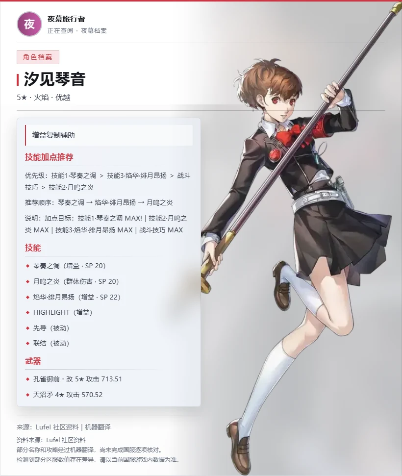
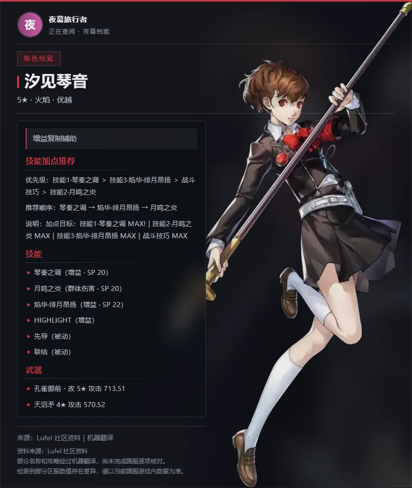
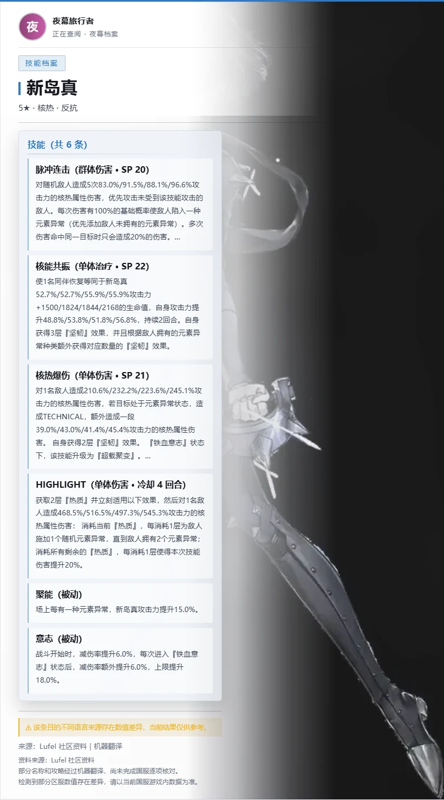
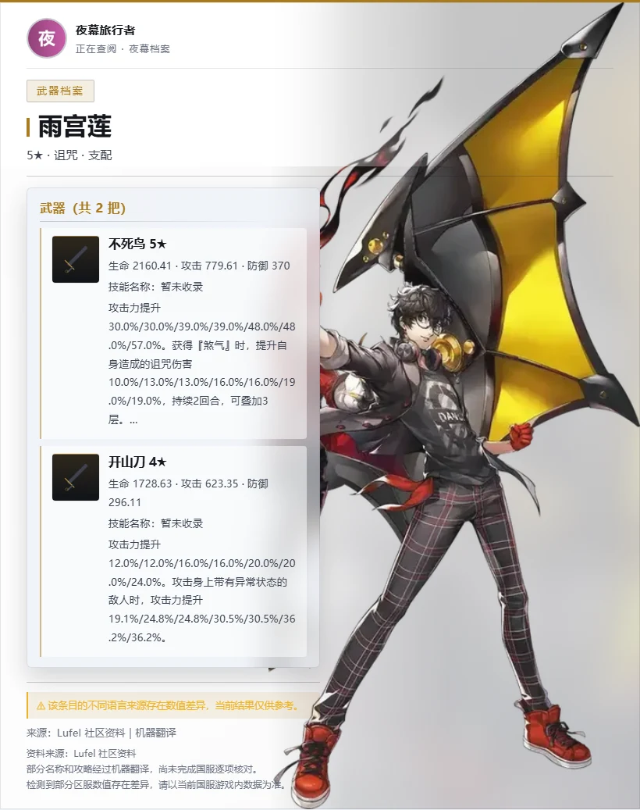
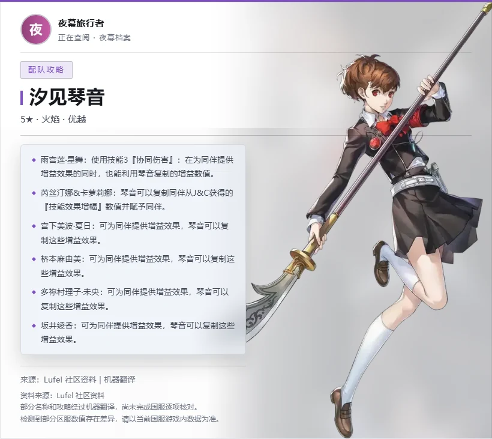
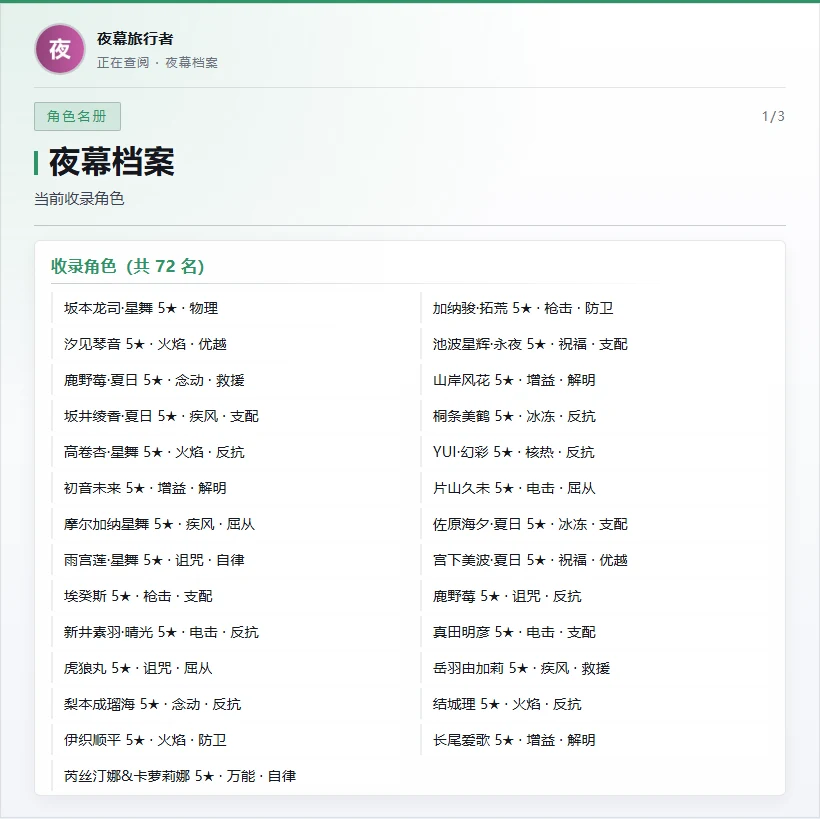
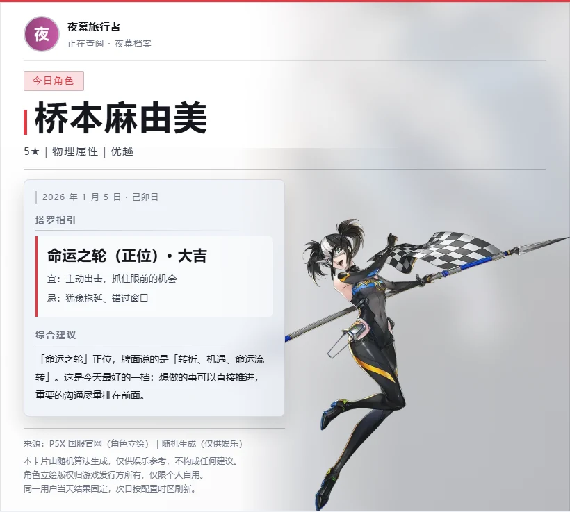
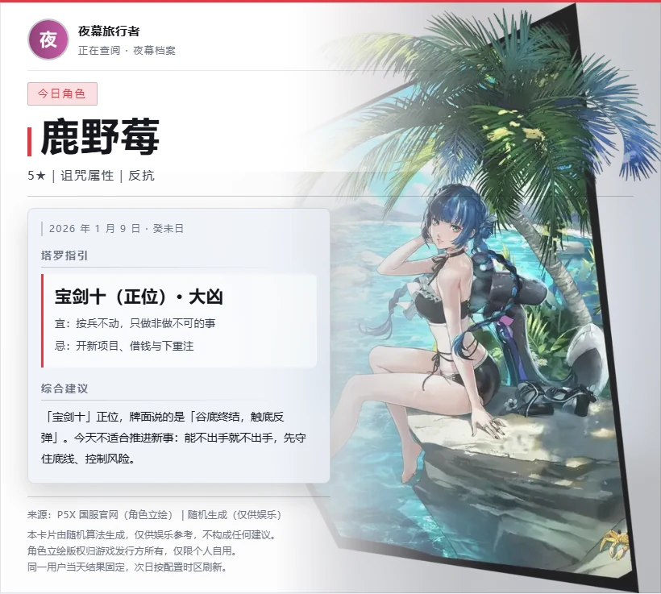

# 夜幕档案

> 面向 AstrBot 的《女神异闻录：夜幕魅影》资料查询与每日运势插件。

[](https://github.com/AstrBotDevs/AstrBot)
[](https://github.com/Yamabuki-Kirio/astrbot_plugin_phantom_archive/releases)
[](https://www.python.org/)

查询角色、技能、武器、意识、养成、操作、评价、配队与攻略，并通过可配置的
T2I 服务生成带用户头像、角色立绘和武器图片的卡片。图片服务不可用时会自动
降级为文字，不影响基础查询。

## 功能特色

- 角色、技能、武器、意识、养成、操作、评价、配队和综合攻略查询
- 角色卡内展示技能加点推荐
- 中文名、原名、英文代号和 slug 多种检索方式
- 暗色 / 浅色图片卡片，支持用户头像、角色立绘和武器缩略图
- 角色立绘 `69/72`，共113张；武器图片 `139/142`
- 每日运势：今日角色（立绘）+ 一张塔罗牌，附大吉 / 吉 / 平 / 凶 / 大凶评级、宜忌与综合建议
- 抽到对应大阿卡纳时，优先选择已进入 P5X 的 P3 / P5 对应角色
- 同一用户当天结果固定，跨群、改名和重启后保持一致
- 资料数据库只读；每日运势单独写入 `p5x_daily.sqlite3`
- 中文数据库、角色立绘和武器图片均随仓库发布，安装后即可使用
- 渲染失败自动回退文字，不调用 LLM

## 预览

下图全部由插件自带的模板 + 真实数据库渲染，没有手工修图（截图里的发起者是测试账号）。

| 角色档案（浅色，默认） | 同一张卡的暗色主题 |
| --- | --- |
|  |  |

| 技能档案 | 武器档案 |
| --- | --- |
|  |  |

| 配队攻略 | 角色名册（两栏） |
| --- | --- |
|  |  |

| 每日运势 · 大吉 | 每日运势 · 大凶 |
| --- | --- |
|  |  |

## 安装

### 在 AstrBot WebUI 安装

进入 `插件管理 → 安装插件 → 从 GitHub 安装`，填写：

```text
https://github.com/Yamabuki-Kirio/astrbot_plugin_phantom_archive
```

安装完成后重启 AstrBot，或在插件管理页面重新加载插件。

### 数据库与素材

中文数据库 `data/p5x_zh.sqlite3`、角色立绘和武器图片均随仓库发布，正常安装后
无需再复制数据库或下载素材。插件以只读方式打开资料库，不会修改它。

如需使用自行维护的数据库，可以在插件配置中通过 `database_path` 指向
`p5x_zh.sqlite3` 的绝对路径。

### 依赖

AstrBot 通常会根据 `requirements.txt` 自动安装依赖。如需手动安装：

```bash
pip install -r requirements.txt
```

## 指令

| 指令 | 说明 | 示例 |
| --- | --- | --- |
| `/夜幕帮助` | 查看插件帮助 | `/夜幕帮助` |
| `/p5x角色 <名称>` | 角色档案、技能、武器与加点推荐 | `/p5x角色 汐见琴音` |
| `/p5x技能 <名称>` | 查询角色技能 | `/p5x技能 新岛真` |
| `/p5x武器 <名称>` | 查询角色武器 | `/p5x武器 雨宫莲` |
| `/p5x角色列表` | 查看已收录角色 | `/p5x角色列表` |
| `/p5x意识 <名称>` | 查询角色意识推荐 | `/p5x意识 高卷杏` |
| `/p5x属性意识 <属性>` | 按属性查询意识 | `/p5x属性意识 火焰` |
| `/p5x养成 <名称>` | 查询养成建议 | `/p5x养成 坂本龙司` |
| `/p5x操作 <名称>` | 查询操作手法 | `/p5x操作 佐仓双叶` |
| `/p5x评价 <名称>` | 查询角色评价 | `/p5x评价 明智吾郎` |
| `/p5x配队 <名称>` | 查询队友、武器、人格面具与配队 | `/p5x配队 汐见琴音` |
| `/p5x攻略 <名称>` | 汇总该角色已有攻略 | `/p5x攻略 汐见琴音` |
| `/p5x每日运势` | 抽取今日角色与运势 | `/p5x每日运势` |
| `/p5x运势` | 每日运势别名 | `/p5x运势` |
| `/p5x今日角色` | 每日运势别名 | `/p5x今日角色` |
| `/p5x抽卡记录` | 预留入口，暂未实现 | `/p5x抽卡记录` |

管理员指令：

| 指令 | 说明 |
| --- | --- |
| `/p5x渲染状态` | 查看T2I、素材和每日运势状态，不显示访问令牌 |
| `/p5x测试渲染` | 使用固定内容测试图片渲染 |

## 图片渲染

图片输出需要兼容 AstrBot T2I 请求格式的 HTML 转图片服务。插件不会写死服务地址，
也不会自动补全 `/generate`，请在配置中填写完整接口 URL。

最小配置：

```text
image_output_enabled = true
t2i_endpoint = http://你的渲染服务:端口/完整路径
```

如服务需要鉴权，再填写 `t2i_token`。令牌只会放进 `Authorization` 请求头，
不会出现在状态指令或日志中。

常用配置：

| 配置项 | 默认值 | 说明 |
| --- | --- | --- |
| `image_output_enabled` | `true` | 是否输出图片卡片 |
| `t2i_endpoint` | 空 | 完整T2I接口地址；留空时使用文字 |
| `t2i_token` | 空 | 可选访问令牌 |
| `t2i_image_format` | `png` | `png` 或 `jpeg` |
| `t2i_quality` | `90` | JPEG图片质量 |
| `t2i_scale` | `hd` | `sd` / `hd` / `fhd` |
| `t2i_fallback_mode` | `text` | 失败后发文字或只报错 |
| `image_theme` | `light` | `light` 浅色纸面（默认） / `dark` 暗色档案卡 |
| `show_requester_header` | `true` | 显示发起者头像和昵称 |
| `show_character_art` | `true` | 显示角色立绘 |
| `show_weapon_art` | `true` | 显示武器图和缩略图 |
| `qq_avatar_url_template` | 空 | 自定义头像模板，必须包含 `{user_id}`；填写后优先于自动推断 |
| `avatar_use_system_proxy` | `false` | 头像下载是否读取系统代理 |

### 头像来源

卡片表头的头像按以下顺序解析，先命中者生效：

| 顺序 | 来源 | 说明 |
| --- | --- | --- |
| 1 | 配置模板 | 填了 `qq_avatar_url_template` 就用它 |
| 2 | QQ 自动 | OneBot 系平台且用户 ID 是纯数字时，自动使用腾讯 qlogo 头像地址 |
| 3 | 平台字段 | 事件对象自带的头像字段（部分适配器会提供） |
| 4 | 首字符 | 以上都没有时，用昵称首字符生成占位头像 |

第 2 步只对 OneBot 生效：Telegram、Discord 的 `user_id` 不是 QQ 号，
拿数字 ID 去猜 QQ 头像只会请求到别人的头像。日志会记录命中的来源
（`config_template` / `qq_auto` / `event` / `initial`）与回退原因，
但不会打印完整地址和用户 ID。

头像下载默认直连，不读系统代理；容器里必须走代理才能访问腾讯头像服务时，
打开 `avatar_use_system_proxy`。头像获取失败时会自动使用昵称首字符，不影响查询。

## 每日运势

每日运势只包含两部分：**今日角色**与**今日塔罗**。

塔罗会给出五档评级（大吉 / 吉 / 平 / 凶 / 大凶）以及对应的宜 / 忌，并写一段
结合牌义的综合建议，全部由「牌名 + 正逆位 + 牌义」查表算出，不调用任何模型：

- 大阿卡纳按传统牌义固定（太阳、世界大吉，高塔大凶，死神、恶魔凶……）；
- 小阿卡纳按「花色 × 点数」给档：权杖看行动、圣杯看情感、宝剑看冲突、星币看物质；
- 逆位一律降一档（大吉→吉→平→凶→大凶），也就是「平的降成凶、凶的降成大凶」；
- 少数逆位在牌义上是解脱或转机的牌（恶魔、高塔、月亮、宝剑十、圣杯四……）单独给档，
  牌义明确破裂失控的（战车、命运之轮、圣杯十……）则比降一档更重；
- 综合建议 = 「牌名 + 正逆位 + 牌义」+ 该档位的行动口径，同一张牌永远同一段话。

由日期、平台和用户 ID 生成固定种子，并保存到独立数据库：

```text
data/p5x_daily.sqlite3
```

同一用户在同一天重复查询、切换群聊、修改昵称或重启插件，都会得到同一结果。
第二天按配置时区自动刷新。

### 正传角色与大阿卡纳

| 阿卡纳 | 优先角色 |
| --- | --- |
| 愚者 | 主角、雨宫莲、结城理、汐见琴音 |
| 魔术师 | 摩尔加纳、伊织顺平 |
| 女祭司 | 新岛真、山岸风花 |
| 皇后 | 奥村春、桐条美鹤 |
| 皇帝 | 喜多川祐介、真田明彦 |
| 教皇 | 荒垣真次郎 |
| 恋人 | 高卷杏、岳羽由加莉 |
| 战车 | 坂本龙司、埃癸斯 |
| 力量 | 虎狼丸、芮丝汀娜与卡萝莉娜 |
| 隐士 | 佐仓双叶 |
| 正义 | 明智吾郎、天田乾 |

抽到以上大阿卡纳时，今日角色优先从对应角色中确定性选取；抽到小阿卡纳或没有
对应角色时，从完整 P5X 角色池选择。特殊形态跟随原角色。

`Faith`、`Aeon` 不属于当前使用的22张大阿卡纳，不强行映射；埃癸斯按其
Persona 的战车阿卡纳处理。

相关配置：

| 配置项 | 默认值 | 说明 |
| --- | --- | --- |
| `daily_fortune_enabled` | `true` | 开启每日运势 |
| `daily_fortune_timezone` | `Asia/Shanghai` | 每日刷新时区 |
| `daily_fortune_image_enabled` | `true` | 每日运势使用图片卡片 |

> 每日运势仅供娱乐，请勿用于医疗、法律、投资或其他重要决策。

## 素材说明

角色立绘和武器图片随插件版本发布，安装后无需额外下载：

```text
角色立绘：69/72，113张
武器图片：139/142
```

当前缺少的3名角色立绘为摩尔加纳·星舞、荒垣真次郎、天田乾。未取得可靠图片的
3项武器为佐原海夕5★武器，以及数据库中未收录名称的两把主角武器。

缺图时自动按以下顺序回退：

```text
角色：角色立绘 → 角色占位图
武器：武器图片 → 所属角色立绘 → 武器占位图
```

角色立绘来自P5X国服官网，标记为 `official`；武器图来自 Lufel 社区角色页，
标记为 `community`。每项素材的来源地址和状态记录在
`data/assets/manifest.json`，详见 [THIRD_PARTY_NOTICES.md](THIRD_PARTY_NOTICES.md)。

## 数据说明

- 角色、技能、武器和攻略数据主要来自 Lufel 社区资料。
- 部分名称和攻略经过机器翻译，尚未完成国服逐项核对。
- 当前数据库存在部分区服数值差异，请以当前国服游戏内数据为准。
- “中文字段覆盖”只表示可以中文显示，不代表国服官方核准。
- 插件使用只读方式打开 `p5x_zh.sqlite3`，不会写入或修改资料库。

## 常见问题

### 安装后提示数据库不存在

正常从完整仓库安装不会缺少数据库。如果出现该提示，请确认安装过程没有过滤大文件，
并检查插件目录下是否存在 `data/p5x_zh.sqlite3`；自定义 `database_path` 时也要确认
路径正确。不要使用原始库 `p5x.sqlite3`。

### 查询只有文字，没有图片

依次检查：

1. `image_output_enabled` 是否开启；
2. `t2i_endpoint` 是否填写完整接口路径；
3. 使用 `/p5x测试渲染` 查看具体错误；
4. 确认 AstrBot 容器可以访问T2I服务地址。

如果T2I运行在另一个 Docker 容器中，请使用容器名和容器端口，不要在容器内填写
`127.0.0.1` 指向宿主机服务。

### 为什么每日运势每天不会变化多次

这是预期行为。结果按“日期 + 平台 + 用户 ID”固定，并写入每日数据库，避免重复抽取
得到不同结果。

### `/p5x抽卡记录` 为什么不能用

P5X抽卡记录涉及游戏内鉴权，目前尚未找到适合普通用户、安全且稳定的读取方案，
所以该指令只保留入口，不要求用户手动提取复杂链接。

## 开发与校验

```bash
python -m pytest tests -q
python scripts/verify_assets.py
```

当前版本校验结果：

```text
576 项测试通过（其中 71 项需要 AstrBot 运行时）
角色立绘 69/72
武器图片 139/142
素材文件 393 个，校验通过
```

项目结构：

```text
archive/       查询、检索、渲染、素材和每日运势逻辑
templates/     HTML卡片模板
data/assets/   角色立绘、武器图、占位图与素材清单
scripts/       素材维护与校验脚本
tests/         自动化测试
main.py        AstrBot指令入口
```

## 致谢

- [AstrBot](https://github.com/AstrBotDevs/AstrBot)
- [astrbot_plugin_cyber_divination](https://github.com/ruoyuxian20-sys/astrbot_plugin_cyber_divination)：塔罗与干支数据基础
- [Lufel](https://lufel.net/)：P5X社区资料与武器图片来源
- 《女神异闻录：夜幕魅影》国服官网：角色立绘来源

## 使用说明

本项目源代码、整理后的数据库与随仓库发布的图片素材均公开提供，项目仅用于
个人学习、资料查询与非商业用途。游戏名称、角色、美术素材及相关知识产权归各自
权利人所有，请勿将本项目或其中素材用于商业销售、付费服务或其他营利用途。

## 反馈

遇到问题时，请在 [Issues](https://github.com/Yamabuki-Kirio/astrbot_plugin_phantom_archive/issues)
中附上：

- AstrBot版本与插件版本
- 使用的平台和适配器
- 触发问题的指令
- 已脱敏的错误日志

请勿提交访问令牌、Cookie、QQ登录信息或其他敏感数据。
